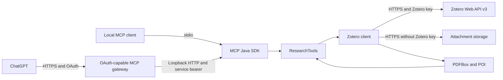

# Architecture

| Component | Responsibility |
| --- | --- |
| `Config` | Environment parsing, library allowlist and outbound proxy selection |
| `Main`, `HttpEndpoint` | Transport startup, HTTP loopback binding, bearer authentication and header validation |
| `ResearchTools` | MCP schemas, input validation, Zotero workflows and citation mapping |
| `Zotero` | Read-only API requests, query encoding, pagination, rate control, and bounded download |
| `Documents` | Page extraction, DOCX and XLSX parsing, and bounded text windows |
| `Duplicates` | DOI, URL, and title normalization and candidate grouping |

## Trust boundaries

The client chooses a configured alias and validated Zotero keys. The server builds every API URL against `https://api.zotero.org` and issues only GET requests. API credentials appear only on the initial Zotero request. The client uses a fresh credential-free request for each HTTPS storage redirect. Attachment links discovered in item metadata are never fetched.

The API connection keeps the JVM's default certificate and hostname verification. HTTP proxy routing uses CONNECT. SOCKS5 supplies the destination name to the proxy without resolving the destination locally. The local system may resolve the proxy host itself.

API requests coordinate per-process `Backoff` and `Retry-After` deadlines. The client retries network connection failures and selected transient HTTP statuses up to three total attempts per request. A longer server backoff causes calls to return early until it expires. Attachments and JSON responses have byte caps. Document parsers still require memory to load and interpret files, so deploy with an appropriate process memory limit and a trusted Zotero library scope.

The HTTP connector accepts local connections on IPv4 loopback, requires a service bearer token, and checks the Host and Origin headers before dispatching MCP requests. The public gateway validates the user's OAuth token independently. The gateway should forward the protocol and session headers, strip browser Origin after any external origin policy it applies, and replace the inbound Authorization header with the upstream service credential.

## Dependencies

| Dependency | Version | Official reference |
| --- | --- | --- |
| MCP Java SDK and Jackson 3 adapter | 2.2.0 | [SDK release](https://github.com/modelcontextprotocol/java-sdk/releases/tag/v2.2.0) |
| Apache Tomcat Embed | 10.1.62 | [Tomcat changelog](https://tomcat.apache.org/tomcat-10.1-doc/changelog.html) |
| OkHttp | 5.4.0 | [OkHttp release](https://github.com/square/okhttp/releases/tag/parent-5.4.0) |
| Apache PDFBox | 3.0.8 | [PDFBox downloads](https://pdfbox.apache.org/download.html) |
| Apache POI OOXML | 6.0.0 | [Apache POI releases](https://poi.apache.org/) |
| jsoup | 1.24.1 | [jsoup release](https://jsoup.org/news/release-1.24.1) |
| JUnit Jupiter | 5.14.3 | [JUnit release](https://github.com/junit-team/junit-framework/releases/tag/r5.14.3) |

[Zotero Web API basics](https://www.zotero.org/support/dev/web_api/v3/basics) · [Zotero full-text API](https://www.zotero.org/support/dev/web_api/v3/fulltext_content) · [MCP transports](https://modelcontextprotocol.io/specification/2025-11-25/basic/transports)
